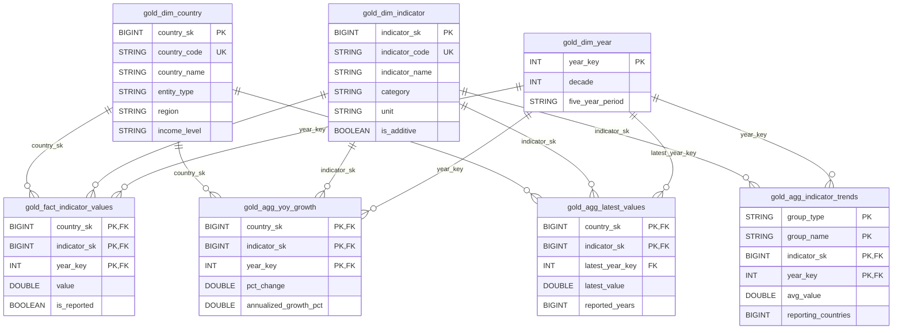

# World Bank Development Analytics

An end-to-end data pipeline project analyzing global socio-economic development indicators (GDP, health, education, environment, connectivity) using the World Bank Open Data API, built with Apache Spark (Databricks) following the Medallion Architecture (Bronze → Silver → Gold).

## Project Overview

This project ingests country-level development data from the World Bank API, processes it through Bronze, Silver, and Gold layers, and culminates in a Power BI dashboard analyzing global development trends. The design, operation, Spark execution analysis and cost evaluation are written up in the Final Architecture and FinOps Report (`proposal/`).

| Item | Value |
|---|---|
| Source | World Bank Open Data API v2 (public, no authentication) |
| Indicators | 84 (69 base + 15 core) |
| Coverage | 1960–2024; 298 country keys in Silver, conformed to 280 countries and aggregates in Gold (224 countries, 56 aggregates) |
| Full load | 1,166,575 records, 292.92 MB of raw JSON (4 files) |
| Incremental load | 41,332 records, 10.27 MB (2023–2024, 2 files) |
| Silver | 1,166,575 rows, one per country, indicator and year |
| Gold | 3 dimensions (280 countries and aggregates, 84 indicators, 65 years), 1 fact table (1,166,575 rows), 3 aggregate tables |
| Operational tables | `pipeline_execution_logs`, `quarantine_records`, `silver_indicator_revisions` |
| Dashboard | Power BI report on the Gold tables (see [Business Intelligence Dashboard](#business-intelligence-dashboard)) |
| Platform | Databricks Free Edition (serverless compute), Delta Lake, Unity Catalog, GitHub |

**What the pipeline guarantees.** Running the same input twice leaves Silver and Gold unchanged (0 rows inserted, 0 updated). A new incremental file flows from Raw to Gold in a single run. Records that do not fit the schema are quarantined and the rest of the batch finishes. Every step writes its layer, source, start and end time, status and row counts to the execution log.

## Project Phases

| Phase | Deliverable | Outcome |
|---|---|---|
| 1 | Proposal: domain, source, full and incremental load, sample files, volume, PII, Medallion plan, dashboard plan | Accepted. On the instructor's feedback the full load was enlarged from a small sample to 70 indicators over 1960–2024 (907,225 records, 230.44 MB, three files) |
| 2 | Bronze and Silver with PySpark: explicit schemas, MERGE upserts, parameterized backfills, schema drift handling, execution logging | 31 of 31 tests passed on Databricks. The first 69 indicators had no GDP, life expectancy or literacy, so 15 core indicators were added through the normal parameters: 84 indicators, 1,166,575 records, 292.92 MB |
| 3 | Gold star schema, pipeline integration, Power BI dashboard, final report | Gold layer refreshed automatically at the end of every run and logged as `silver_to_gold`; Power BI dashboard built on the Gold tables |

## Data Source

- **API**: [World Bank Open Data API](https://api.worldbank.org/v2/)
- **Base endpoint**: `https://api.worldbank.org/v2/country/all/indicator/{indicator_code}?format=json`
- **No authentication required**

### Indicators Used

The dataset has **84 indicators** in two sets:

1. **Base set (69 indicators).** 70 indicators were requested and 69 returned data (codes and names in `data/raw/Metadata/indicators_70.json`). They cover agriculture and land, aid flows, education attainment (Barro-Lee), electricity access and energy, and a few income and consumption series. The base set was picked from World Bank topic lists and did **not** contain the headline indicators (GDP, life expectancy, literacy). The only GDP-like series in it (`6.0.GDP_*`) cover about 22 countries for 2000–2014.
2. **Core set (15 indicators).** Pulled in a second batch by `Ingestion/core_indicator_fetch.ipynb` (codes and names in `data/raw/Metadata/indicators_core.json`):

| Indicator | Code |
|---|---|
| GDP (current US$) | `NY.GDP.MKTP.CD` |
| GDP per capita (current US$) | `NY.GDP.PCAP.CD` |
| GDP growth (annual %) | `NY.GDP.MKTP.KD.ZG` |
| Population, total | `SP.POP.TOTL` |
| Life expectancy at birth | `SP.DYN.LE00.IN` |
| Literacy rate, adult total | `SE.ADT.LITR.ZS` |
| Mortality rate, under-5 | `SH.DYN.MORT` |
| Health expenditure (% GDP) | `SH.XPD.CHEX.GD.ZS` |
| School enrollment, primary | `SE.PRM.ENRR` |
| School enrollment, secondary | `SE.SEC.ENRR` |
| Internet users (% of population) | `IT.NET.USER.ZS` |
| CO2 emissions per capita | `EN.GHG.CO2.PC.CE.AR5` |
| Poverty headcount ($2.15/day) | `SI.POV.DDAY` |
| Inflation (%) | `FP.CPI.TOTL.ZG` |
| Unemployment (%) | `SL.UEM.TOTL.ZS` |

`EN.ATM.CO2E.PC` returned no data and was replaced by `EN.GHG.CO2.PC.CE.AR5`.

**Coverage differs by indicator.** Each core indicator has 17,290 country-year rows. GDP has 14,577 reported values (84%), life expectancy 17,191 (99%), and literacy only 2,804 (16%) because it comes from surveys, so Phase 3 should use the latest available literacy value per country.

## Ingestion Pattern

- **Full Load**: Complete historical time series (**1960–2024**) for all selected indicators across all countries and regional aggregates.
- **Incremental Load**: Re-pull of the latest 1–2 reporting years (2023–2024) for the same indicators, to detect newly available records and revised (corrected) values, since World Bank data is periodically updated rather than streamed daily.

## Data Volume

| Metric | Full Load | Incremental Load |
|---|---|---|
| Base set (69 indicators) | 907,225 records, 230.44 MB (3 files) | 33,352 records, 8.34 MB |
| Core set (15 indicators) | 259,350 records, 62.48 MB (1 file) | 7,980 records, 1.93 MB |
| **Total** | **1,166,575 records, 292.92 MB** | **41,332 records, 10.27 MB** |
| Years | 1960–2024 | 2023–2024 |

GitHub rejects files larger than 100 MB, so the base full load is stored as **three part files** (~74–79 MB each). Each part is a valid JSON array, and together they form the base baseline.

To recombine the base parts:

```python
import json

full_load = []
for i in (1, 2, 3):
    with open(f"data/raw/full/full_load_part{i}.json") as f:
        full_load.extend(json.load(f))

print(len(full_load), "records")
```

## Repository Structure

```
World_Bank_Analytics/
├── README.md
├── Ingestion/
│   ├── World bank pipeline.ipynb        # Phase 1: API extraction of the base set (full + incremental pulls)
│   └── core_indicator_fetch.ipynb       # Pulls the 15 core indicators (run once)
├── data/
│   ├── raw/
│   │   ├── full/
│   │   │   ├── full_load_part1.json     # Base full load, part 1 of 3
│   │   │   ├── full_load_part2.json     # Base full load, part 2 of 3
│   │   │   ├── full_load_part3.json     # Base full load, part 3 of 3
│   │   │   └── full_load_core.json      # Core indicators, full load
│   │   ├── incremental/
│   │   │   ├── incremental_full.json    # Base set, latest years
│   │   │   └── incremental_core.json    # Core indicators, latest years
│   │   └── Metadata/
│   │       ├── indicators_70.json       # Base indicator codes and names
│   │       ├── indicators_core.json     # Core indicator codes and names
│   │       └── countries_metadata.json  # World Bank country list (region, income level, aggregates), used by Gold
├── Pipeline/                            # keep these notebooks in the same folder (%run ./...)
│   ├── bronze_silver layer.ipynb        # Bronze & Silver schemas and transformations
│   ├── gold_layer.ipynb                 # Gold star schema transformations (dimensions, fact, aggregates)
│   ├── pipeline_utils.ipynb             # Table definitions, MERGE logic, quarantine, execution logging, Gold refresh
│   ├── run_pipeline.ipynb               # Parameterized pipeline entry point (widgets)
│   ├── pipeline_tests.ipynb             # Idempotency / upsert / backfill / schema drift / logging / Gold tests
│   ├── gold_optimization.ipynb          # Liquid clustering / OPTIMIZE demonstration on the Gold tables
│   └── test_data/
│       ├── sample_baseline.json         # 34-record baseline used by the tests
│       ├── sample_revisions.json        # revised / newly reported / new records
│       └── sample_schema_drift.json     # new column, wrong types, missing fields
├── dashboard/
│   └── World_bank_dashboard.pbix        # Power BI report (Import mode snapshot of the Gold tables)
└── proposal/                            # Phase 1 proposal, Phase 2 report and the Final Architecture and FinOps Report
    └── Phase1_Proposal.docx
```

`Pipeline/` notebooks load each other with `%run "./bronze_silver layer"`, `%run "./gold_layer"` and `%run ./pipeline_utils`, and relative file paths are resolved from the notebook's own folder. This is why the raw data is referenced as `../data/raw/...`.

## Medallion Architecture

- **Bronze**: Raw JSON as returned by the API, one record per (country, indicator, year), plus lineage columns.
- **Silver**: Cleansed data: flattened fields, cast types, standardized country keys, null handling, upsert logic for revised records.
- **Gold**: Star schema (`gold_dim_country`, `gold_dim_indicator`, `gold_dim_year`, `gold_fact_indicator_values`) with pre-aggregated tables for regional trends (`gold_agg_indicator_trends`), year-over-year growth (`gold_agg_yoy_growth`) and the latest value per country (`gold_agg_latest_values`). See [Phase 3](#phase-3-gold-layer).

---

# Phase 2: Bronze & Silver Implementation

All tables are Delta tables created in `<catalog>.world_bank` (on Databricks Free Edition the catalog is `workspace`). Tables are created with explicit DDL by `create_tables()` in `pipeline_utils.ipynb`.

## Pipeline Flow

```
raw JSON files ──(explicit StructType, no inference)──► Bronze ──(clean, cast, dedupe)──► Silver ──(star schema)──► Gold
      │                                                   │                                  │
      └── unreadable / unidentifiable rows ──► quarantine_records ◄── rows that fail casting ─┘
                                                                     value changes ──► silver_indicator_revisions
every file / table processed ──► pipeline_execution_logs
```

The Gold step is described in [Phase 3](#phase-3-gold-layer).

## Data Dictionary

### Bronze: `bronze_indicator_values`

Raw records exactly as returned by the API. All leaf fields are kept as strings so a type change in the source is never silently lost; casting happens in Silver.

**Primary key:** `(batch_id, record_hash)`

| Column | Type | Description |
|---|---|---|
| `indicator` | STRUCT<id: STRING, value: STRING> | Indicator code and name |
| `country` | STRUCT<id: STRING, value: STRING> | World Bank country/region id and name |
| `countryiso3code` | STRING | ISO3 code (empty for some aggregates and territories) |
| `date` | STRING | Year as sent by the API |
| `value` | STRING | Indicator value as raw text (null when not reported) |
| `unit` | STRING | Unit (empty in this dataset) |
| `obs_status` | STRING | Observation status (empty in this dataset) |
| `decimal` | STRING | Decimal precision |
| `_rescued_data` | STRING | JSON of any fields that did not match the schema (schema drift) |
| `record_hash` | STRING | SHA-256 of the raw record content |
| `source_file` | STRING | Raw file the record came from |
| `batch_id` | STRING | Batch identifier (pipeline parameter) |
| `load_type` | STRING | `full` or `incremental` |
| `load_timestamp` | TIMESTAMP | When the record was ingested into Bronze |

### Silver: `silver_indicator_values`

One cleansed row per country, indicator and year.

**Primary key:** `(country_key, indicator_code, year)`

| Column | Type | Description |
|---|---|---|
| `country_key` | STRING | `country.id`, or `NAME_<COUNTRY_NAME>` when the API sends an empty id (e.g. Niue, Tokelau, Anguilla in the Barro-Lee indicators) |
| `country_code` | STRING | World Bank country/region id |
| `country_iso3` | STRING | ISO3 code (null when empty) |
| `country_name` | STRING | Country/region name |
| `indicator_code` | STRING | Indicator code |
| `indicator_name` | STRING | Indicator name |
| `year` | INT | Year (cast from `date`) |
| `value` | DOUBLE | Indicator value (cast from raw text) |
| `is_reported` | BOOLEAN | `false` when the API has no value for this country-year (kept, not dropped) |
| `decimal_places` | INT | Decimal precision (cast from `decimal`) |
| `source_batch_id` | STRING | Batch that last inserted/changed the row |
| `source_file` | STRING | Raw file of that batch |
| `source_load_timestamp` | TIMESTAMP | Bronze load time of the source record |
| `load_timestamp` | TIMESTAMP | When the row was last inserted/updated in Silver |

Bronze → Silver steps: flatten the `country` and `indicator` structs, trim and convert empty strings to null, build `country_key`, cast `date` → INT, `value` → DOUBLE and `decimal` → INT with `try_cast` (bad values become quarantined instead of failing the batch), flag `is_reported`, keep the latest record per key, then `MERGE INTO` Silver.

### Silver: `silver_indicator_revisions`

History of values changed by later loads (the old → new value of every update).

| Column | Type | Description |
|---|---|---|
| `country_key`, `indicator_code`, `year` | STRING, STRING, INT | Silver key of the changed row |
| `old_value` / `new_value` | DOUBLE | Value before and after |
| `change_type` | STRING | `newly_reported` (null → value), `value_revised`, `value_removed` |
| `old_batch_id` / `new_batch_id` | STRING | Batch that set the old value / the new value |
| `load_timestamp` | TIMESTAMP | When the revision was recorded |

### Operational: `quarantine_records`

| Column | Type | Description |
|---|---|---|
| `layer` | STRING | `raw_to_bronze` or `bronze_to_silver` |
| `batch_id`, `source_file` | STRING | Where the record came from |
| `reason` | STRING | `missing_indicator_id`, `missing_date`, `missing_country`, `invalid_year`, `value_not_numeric` |
| `record_hash` | STRING | Hash of the raw record |
| `raw_record` | STRING | The rejected record as JSON |
| `load_timestamp` | TIMESTAMP | When it was quarantined |

### Operational: `pipeline_execution_logs`

One row for every file or table processed, for every run, in every layer.

**Primary key:** `log_id`

| Column | Type | Description |
|---|---|---|
| `log_id` | STRING | Unique id of the log entry |
| `run_id` | STRING | Same for all steps of one pipeline run |
| `layer` | STRING | `raw_to_bronze`, `bronze_to_silver` or `silver_to_gold` |
| `load_type` | STRING | `full` or `incremental` |
| `batch_id` | STRING | Batch parameter |
| `source` | STRING | File (Raw → Bronze), table + batch (Bronze → Silver) or `source table -> Gold table` (Silver → Gold) processed |
| `start_time` / `end_time` | TIMESTAMP | Execution start and end |
| `duration_seconds` | DOUBLE | Run time of the step |
| `status` | STRING | `SUCCESS` or `FAILED`. FAILED means an error occurred inside the step (the error text is in `message`). A run cancelled manually while a step is executing can leave a row with an empty status |
| `rows_read` | BIGINT | Records read |
| `rows_inserted` | BIGINT | Rows inserted by the MERGE |
| `rows_updated` | BIGINT | Rows updated by the MERGE |
| `rows_quarantined` | BIGINT | Rows sent to `quarantine_records` |
| `rows_aggregated` | BIGINT | Rows produced by a Silver → Gold step (see [Gold logging](#logging-of-the-gold-steps)) |
| `message` | STRING | Error message on failure, or notes (schema drift, revisions recorded, quarantined rows). Null when a Raw → Bronze step finished without notes |
| `load_timestamp` | TIMESTAMP | When the log row was written |

## Robustness

**Idempotency (MERGE INTO).** Both layers are loaded with `MERGE INTO`, never with append/overwrite:
- Bronze: insert-only MERGE on `(batch_id, record_hash)`. Re-loading the same file for the same batch inserts 0 rows.
- Silver: upsert on `(country_key, indicator_code, year)`. New keys are inserted; existing keys are updated only if a value actually changed **and** the incoming record is at least as recent as the one already stored. Re-running the same data gives 0 inserts and 0 updates, and re-processing an older batch cannot overwrite newer values.
- Revisions and quarantine tables are also written with MERGE, so re-runs do not duplicate them.

**Parameterized backfills.** Nothing is hardcoded to "today" or to one user's folder. File paths, batch id, load type, layer and target schema are parameters (see the execution guide).

**Schema drift.**
- New/unexpected columns in the source are not dropped: they are captured in `_rescued_data` and the record is still loaded. The log row notes how many records had drift.
- Type changes (e.g. `value` sent as text) are kept as raw strings in Bronze; in Silver `try_cast` turns non-conforming values into quarantined records instead of failing the batch.
- Records that cannot be identified (missing indicator, year or country, or a field sent with a different structure) are quarantined at Raw → Bronze.
- The Bronze MERGE uses `WITH SCHEMA EVOLUTION`, so if a new field is added to `bronze_schema` the table evolves automatically.
- Each file is processed and logged separately: one failing file is logged as `FAILED` and the other files of the batch still load.

## Execution Guide

Open **`Pipeline/run_pipeline.ipynb`**, set the widgets at the top and click **Run all**. The same names can be passed as job parameters when the notebook is run as a Databricks Job.

| Widget | Default | Description |
|---|---|---|
| `load_type` | `incremental` | `full` or `incremental` |
| `source_path` | *(empty)* | File, folder, wildcard or comma-separated list. Empty = every `.json` file in `data/raw/full` (full) or `data/raw/incremental` (incremental). Relative paths are resolved from the notebook's folder, so from `Pipeline/` they start with `../data/raw/`. Absolute `/Workspace/...`, `/Volumes/...` and `dbfs:/...` paths also work |
| `batch_id` | *(empty)* | Empty = `full_load` (full) or `incremental_<YYYYMMDD>` (incremental). With `layer = silver`, selects which Bronze batch to process; `ALL` = every batch |
| `layer` | `all` | Where the run starts: `all` (Raw → Bronze → Silver → Gold), `bronze` (Raw → Bronze only), `silver` (Bronze → Silver → Gold) or `gold` (Silver → Gold only). Gold is refreshed at the end of every run that loads Silver |
| `catalog` | *(empty)* | Empty = current catalog |
| `schema` | `world_bank` | Schema for all pipeline tables |

### 1. Initial full load (run once)

| load_type | source_path | batch_id | layer |
|---|---|---|---|
| `full` | *(empty)* | *(empty)* | `all` |

Loads every file in `data/raw/full` (the three base parts and `full_load_core.json`) into Bronze as batch `full_load` and merges them into Silver. Each file gets its own log row.

### 2. Standard incremental load (scheduled, e.g. weekly)

| load_type | source_path | batch_id | layer |
|---|---|---|---|
| `incremental` | *(empty)* | *(empty)* | `all` |

Loads every file in `data/raw/incremental` (`incremental_full.json` and `incremental_core.json`) as batch `incremental_<today>` and upserts it into Silver. New country-years are inserted, revised values are updated and recorded in `silver_indicator_revisions`. Keep only the current pull in that folder; move older incremental files elsewhere and load them as backfills.

### 3. Backfill a historical batch (Raw → Bronze → Silver)

Point the pipeline at one raw file or folder and give the batch its own id:

| load_type | source_path | batch_id | layer |
|---|---|---|---|
| `incremental` | `../data/raw/incremental/incremental_core.json` | `incremental_core` | `all` |

`source_path` can also be a folder or a pattern (for example `../data/raw/full/full_load_part*.json`). For an older period, use the same pattern with that period's file and a batch id that names it (for example `incremental_20251231`). A backfill never overwrites newer values already in Silver.

### 4. Re-process Bronze → Silver only

| Purpose | load_type | batch_id | layer |
|---|---|---|---|
| Re-run one batch from Bronze | `incremental` | `incremental_<YYYYMMDD>` | `silver` |
| Re-run the full-load batch (base and core files) from Bronze | `full` | `full_load` | `silver` |
| Rebuild Silver from every Bronze batch | `full` | `ALL` | `silver` |

Because Silver is loaded with a guarded MERGE, any of these can be run as many times as needed without creating duplicates. Each run also refreshes Gold.

### 5. Refresh Gold only

| load_type | batch_id | layer |
|---|---|---|
| `incremental` | *(empty)* | `gold` |

Reads the Silver rows changed since the last Gold refresh (0 rows if nothing changed). Use it the first time Gold is added on top of an existing Silver table, or after a failed Gold step. To rebuild Gold from scratch, drop the seven Gold tables (fact and aggregates first) and run the same command:

```python
tables = get_tables()
for key in ["fact", "agg_trends", "agg_yoy", "agg_latest", "dim_country", "dim_indicator", "dim_year"]:
    spark.sql(f"DROP TABLE IF EXISTS {tables[key]}")
```

### 6. Tests

Run **`Pipeline/pipeline_tests.ipynb`**. Part A runs the pipeline on `Pipeline/test_data/` in a separate schema (`world_bank_test`) and checks idempotency, upserts, backfill, schema drift, quarantine, failure logging and the Gold layer (row counts, surrogate keys, orphan keys, incremental fact MERGE, aggregate values and the `silver_to_gold` log rows). Part B runs read-only checks on the real tables. The last cell fails if any check fails.

### 7. Gold performance demo

Run **`Pipeline/gold_optimization.ipynb`** after a load. It shows the clustering columns and file counts of the Gold tables, runs `OPTIMIZE`, shows the table history and compares a star schema query with the same query on the aggregate table.

### Checking the logs

```sql
SELECT run_id, layer, source, status, rows_read, rows_inserted, rows_updated,
       rows_quarantined, rows_aggregated, duration_seconds, start_time, end_time, message
FROM workspace.world_bank.pipeline_execution_logs
ORDER BY start_time DESC;
```

## Validation

- Raw files reconciled with the documented volumes: base set 907,225 full-load and 33,352 incremental records, core set 259,350 and 7,980 (totals 1,166,575 and 41,332).
- After both full loads Silver holds 1,166,575 rows (520,215 with a reported value, 646,360 without).
- Re-running the same load inserts 0 rows and updates 0 rows. The real incremental files contain the same values as the full loads for 2023–2024, so they also insert and update 0 rows in Silver; revisions, inserts and updates are demonstrated with `test_data/sample_revisions.json`.
- `pipeline_tests` passed 31 / 31 checks on Databricks (Phase 2 checks). The Gold checks were added to the same notebook in Phase 3.
- Silver check for the core indicators: GDP, GDP per capita, life expectancy and literacy each have 17,290 rows, with 14,577, 14,577, 17,191 and 2,804 reported values.
- Gold tables in the Power BI model: fact rows equal Silver rows (1,166,575); 280 countries and aggregates (224 countries, 56 aggregates); 84 indicators; 65 years.
- Silver → Gold in the execution log: 7 table steps and `OPTIMIZE`, all `SUCCESS`. The first Gold build took 116.2 s; a refresh with no changes took 25.9 s.

## Notes and Limitations

- With the default `batch_id`, running the incremental load on a different day creates a new Bronze batch (`incremental_<date>`). Silver is not affected. To re-run the same batch, pass the same `batch_id`.
- Bronze keeps one copy of a record per batch. If the same raw file is loaded under two batch ids, it appears twice in Bronze; Silver is not affected because its key is `(country_key, indicator_code, year)`.
- Schema drift handling relies on the Databricks `rescuedDataColumn` option. New source columns are preserved in `_rescued_data` rather than added as table columns. To promote a new column, add it to `bronze_schema`; the Bronze MERGE then evolves the table.
- Primary keys on Silver and the log table are informational constraints (Unity Catalog). Uniqueness is enforced by the MERGE logic.
- The execution log is an audit trail and is never cleaned. It can contain earlier test runs that FAILED or were cancelled; those committed no data.

---

# Phase 3: Gold Layer

The Gold layer turns the Silver table into a star schema for the BI dashboard. It is built by `Pipeline/gold_layer.ipynb` (transformations) and `Pipeline/pipeline_utils.ipynb` (DDL, MERGE and orchestration), and runs automatically at the end of every pipeline run that loads Silver.

## Dimensional Model

Star schema with one fact table at the grain **country × indicator × year**, three dimensions and three pre-aggregated tables for the dashboard. What Gold adds on top of Silver:

- **Surrogate keys.** The dimensions have `BIGINT` identity keys (`country_sk`, `indicator_sk`). The fact only stores keys and measures, and joins are on small integers instead of strings.
- **Conformed country dimension.** The LAC Equity Lab indicators send 18 Latin American countries with their ISO3 id (`ARG`, `BRA`, ...) while all other indicators use the 2-letter id (`AR`, `BR`, ...). In Silver they are separate keys. In Gold both map to the same `gold_dim_country` row, so the 298 Silver keys become **280** countries and aggregates. They never share an indicator, so no fact rows collide.
- **Enrichment from reference data.** `data/raw/Metadata/countries_metadata.json` (World Bank `/v2/country` endpoint, saved once by `Ingestion/World bank pipeline.ipynb`) adds the entity type (country or aggregate), region, income level, lending type, capital city and coordinates (for map visuals). 14 entities that are not in that list (LAC sub-regions, and territories sent with an empty id such as Niue or Anguilla) are classified in `EXTRA_ENTITIES` in `Pipeline/gold_layer.ipynb`.
- **Indicator attributes.** Theme (`category`), source database, unit and an `is_additive` flag, so the dashboard only sums indicators where a total makes sense (GDP, population, sq. km, hectares, US$) and averages the rest (percentages, per-capita values).
- **Time dimension.** Every year from the first to the last Silver year, with decade and five-year period for grouping.

### ER Diagram



The primary and foreign keys are also created as Unity Catalog informational constraints, so Catalog Explorer shows the same relationships. They are not enforced by Delta; the pipeline makes sure the keys are valid (the fact step fails if a Silver row has no dimension member, and the tests check that there are no orphan keys).

## Gold Data Dictionary

### Dimension: `gold_dim_country`

One row per country, territory or World Bank aggregate. SCD type 1 (attributes are overwritten, there is no history).

**Primary key:** `country_sk` · **Business key:** `country_code`

| Column | Type | Description |
|---|---|---|
| `country_sk` | BIGINT | Surrogate key (identity column) |
| `country_code` | STRING | World Bank 2-letter id (`PK`, `ZH`, ...). ISO3 ids are mapped to it; entities with no id keep the Silver `NAME_<name>` key |
| `country_name` | STRING | Name from `countries_metadata.json`, otherwise from Silver |
| `iso3_code` | STRING | ISO3 code |
| `entity_type` | STRING | `Country` or `Aggregate` (`Unclassified` if an entity is in neither reference list) |
| `region` | STRING | World Bank region, countries only (e.g. `South Asia`) |
| `income_level` | STRING | World Bank income group, countries only |
| `lending_type` | STRING | IBRD / IDA / Blend, countries only |
| `capital_city` | STRING | Capital city |
| `latitude`, `longitude` | DOUBLE | Capital city coordinates |
| `source_country_keys` | STRING | Silver `country_key` value(s) mapped to this row (e.g. `AR, ARG`) |
| `load_timestamp` | TIMESTAMP | When the row was last inserted/updated |

### Dimension: `gold_dim_indicator`

One row per indicator. SCD type 1.

**Primary key:** `indicator_sk` · **Business key:** `indicator_code`

| Column | Type | Description |
|---|---|---|
| `indicator_sk` | BIGINT | Surrogate key (identity column) |
| `indicator_code` | STRING | World Bank indicator code |
| `indicator_name` | STRING | Indicator name |
| `category` | STRING | `Economy`, `Population`, `Health`, `Education`, `Labor`, `Poverty`, `Connectivity`, `Environment`, `Energy`, `Agriculture & Land` or `Aid & Grants` (from the code prefix, e.g. `NY.` = national accounts) |
| `source_dataset` | STRING | `World Development Indicators`, `Barro-Lee Educational Attainment` or `LAC Equity Lab` |
| `unit` | STRING | Unit from the indicator name (e.g. `% of land area`, `current US$`); set by hand for the 3 core indicators whose name has none (`UNIT_OVERRIDES`) |
| `is_additive` | BOOLEAN | `true` when values can be summed across countries (GDP, population, sq. km, hectares, US$; never for per capita indicators) |
| `load_timestamp` | TIMESTAMP | When the row was last inserted/updated |

### Dimension: `gold_dim_year`

One row per year from the first to the last year in Silver (1960–2024 for the real data).

**Primary key:** `year_key`

| Column | Type | Description |
|---|---|---|
| `year_key` | INT | The year itself (e.g. `2023`) |
| `decade` | INT | e.g. `2020` |
| `decade_label` | STRING | e.g. `2020s` |
| `five_year_period` | STRING | e.g. `2020-2024` |
| `load_timestamp` | TIMESTAMP | When the row was inserted |

### Fact: `gold_fact_indicator_values`

One row per country, indicator and year (same number of rows as Silver: 1,166,575). Rows without a reported value are kept with `is_reported = false`, so the dashboard can show data coverage.

**Primary key:** `(country_sk, indicator_sk, year_key)` · **Liquid clustering:** `indicator_sk, year_key`

| Column | Type | Description |
|---|---|---|
| `country_sk` | BIGINT | FK → `gold_dim_country` |
| `indicator_sk` | BIGINT | FK → `gold_dim_indicator` |
| `year_key` | INT | FK → `gold_dim_year` |
| `value` | DOUBLE | Indicator value (NULL when not reported) |
| `is_reported` | BOOLEAN | `false` when the API has no value |
| `decimal_places` | INT | Decimal precision |
| `source_batch_id` | STRING | Batch that last changed the Silver row |
| `silver_load_timestamp` | TIMESTAMP | `load_timestamp` of the Silver row, used as the incremental watermark |
| `load_timestamp` | TIMESTAMP | When the row was last inserted/updated in Gold |

### Aggregate: `gold_agg_indicator_trends`

Indicator values summarised per region, per income level and for the whole world. Only real countries are used (World Bank aggregates are excluded so nothing is counted twice).

**Primary key:** `(group_type, group_name, indicator_sk, year_key)` · **Liquid clustering:** `indicator_sk, group_type`

| Column | Type | Description |
|---|---|---|
| `group_type` | STRING | `Region`, `Income level` or `World` |
| `group_name` | STRING | e.g. `South Asia`, `Low income`, `World` |
| `indicator_sk` | BIGINT | FK → `gold_dim_indicator` |
| `year_key` | INT | FK → `gold_dim_year` |
| `country_count` | BIGINT | Countries in the group |
| `reporting_countries` | BIGINT | Countries with a value |
| `coverage_pct` | DOUBLE | `reporting_countries / country_count × 100` |
| `avg_value` | DOUBLE | Simple average across countries (not population weighted) |
| `median_value` | DOUBLE | Approximate median |
| `min_value`, `max_value` | DOUBLE | Lowest / highest country value |
| `sum_value` | DOUBLE | Total, only for additive indicators (NULL otherwise) |
| `load_timestamp` | TIMESTAMP | When the table was rebuilt |

### Aggregate: `gold_agg_yoy_growth`

Change of every reported value against the previous reported year of the same country and indicator. Many indicators are not published every year (Barro-Lee only every 5 years), so the gap is kept and an annualized rate is given as well.

**Primary key:** `(country_sk, indicator_sk, year_key)` · **Liquid clustering:** `indicator_sk, country_sk`

| Column | Type | Description |
|---|---|---|
| `country_sk` | BIGINT | FK → `gold_dim_country` |
| `indicator_sk` | BIGINT | FK → `gold_dim_indicator` |
| `year_key` | INT | FK → `gold_dim_year` |
| `value` | DOUBLE | Value in this year |
| `prev_year_key` | INT | Previous year with a reported value (NULL for the first one) |
| `prev_value` | DOUBLE | Value in that year |
| `years_gap` | INT | `year_key - prev_year_key` |
| `abs_change` | DOUBLE | `value - prev_value` |
| `pct_change` | DOUBLE | Change in % of `prev_value` (NULL when `prev_value` is 0) |
| `annualized_growth_pct` | DOUBLE | Average growth per year over the gap (only when both values are positive) |
| `load_timestamp` | TIMESTAMP | When the table was rebuilt |

### Aggregate: `gold_agg_latest_values`

Latest reported value of every country and indicator. Survey based indicators such as literacy (16% of country-years reported) or poverty are not published every year, so maps and rankings use the latest available value instead of one fixed year.

**Primary key:** `(country_sk, indicator_sk)` · **Liquid clustering:** `indicator_sk`

| Column | Type | Description |
|---|---|---|
| `country_sk` | BIGINT | FK → `gold_dim_country` |
| `indicator_sk` | BIGINT | FK → `gold_dim_indicator` |
| `latest_year_key` | INT | FK → `gold_dim_year`, last year with a reported value |
| `latest_value` | DOUBLE | Value in `latest_year_key` |
| `first_year_key` | INT | First year with a reported value |
| `reported_years` | BIGINT | Number of years with a value |
| `load_timestamp` | TIMESTAMP | When the table was rebuilt |

## Refresh Strategy

`refresh_gold()` runs after the Bronze → Silver step of every run (`layer = all` or `silver`), or on its own with `layer = gold`. The tables are refreshed in dependency order, and if one step fails the remaining steps are skipped and the run is reported as failed.

| Order | Table | Strategy | Why |
|---|---|---|---|
| 1–3 | `gold_dim_country`, `gold_dim_indicator`, `gold_dim_year` | `MERGE` (SCD type 1): insert new members, update only changed attributes | Surrogate keys must stay the same on every load, so the dimensions are never overwritten |
| 4 | `gold_fact_indicator_values` | Incremental `MERGE` on `(country_sk, indicator_sk, year_key)` | Only Silver rows with `load_timestamp` newer than the newest `silver_load_timestamp` in the fact are read. Silver only changes a row when its content changed, so an incremental file with a few hundred revisions touches a few hundred fact rows |
| 5–7 | `gold_agg_indicator_trends`, `gold_agg_yoy_growth`, `gold_agg_latest_values` | `INSERT OVERWRITE`, only when an input table changed since the last rebuild | One revised value changes a regional average and the growth rate of the next year, so these tables are recomputed as a whole (one atomic Delta commit). If nothing changed they are skipped |
| 8 | changed fact / aggregate tables | `OPTIMIZE` | Clusters the newly written files (see below) |

Re-running the pipeline on the same data gives 0 inserts and 0 updates in every Gold table, and the aggregate rebuild and `OPTIMIZE` are skipped. Re-processing an old batch from Bronze does not change Silver, so it does not change Gold either.

## Logging of the Gold steps

Every Gold table is its own row in `pipeline_execution_logs` with `layer = silver_to_gold`, `source = <input table> -> <Gold table>`, the execution time (`start_time`, `end_time`, `duration_seconds`) and these counters:

| Step | `rows_read` | `rows_inserted` / `rows_updated` | `rows_aggregated` |
|---|---|---|---|
| Dimensions | Silver rows scanned | MERGE result | Members built (distinct countries / indicators / years) |
| Fact | Silver rows changed since the last refresh | MERGE result | Rows sent to the MERGE |
| Aggregates | Fact rows | Rows written / 0 | Aggregate rows produced (0 when skipped) |

The `OPTIMIZE` step is logged with `source = OPTIMIZE gold tables` and the list of tables in `message`.

```sql
SELECT source, status, rows_read, rows_inserted, rows_updated, rows_aggregated, duration_seconds, message
FROM workspace.world_bank.pipeline_execution_logs
WHERE layer = 'silver_to_gold'
ORDER BY start_time DESC;
```

## Performance Optimization

- **Liquid clustering** (`CLUSTER BY`) on the fact and the aggregate tables. The keys follow how the dashboard filters: almost every visual selects one indicator first, then a year range, a group or a set of countries. Delta keeps min/max statistics per file for these columns and skips files that cannot contain the filtered values.

  | Table | Clustering keys |
  |---|---|
  | `gold_fact_indicator_values` | `indicator_sk`, `year_key` |
  | `gold_agg_indicator_trends` | `indicator_sk`, `group_type` |
  | `gold_agg_yoy_growth` | `indicator_sk`, `country_sk` |
  | `gold_agg_latest_values` | `indicator_sk` |

- **`OPTIMIZE`** runs at the end of every Gold refresh that changed data. On a liquid clustered table it only rewrites files that are not clustered yet, so it stays cheap on incremental runs.
- **Dimensions are not clustered.** They have at most a few hundred rows, so Spark broadcasts them in joins and clustering would not help.
- **Pre-aggregated tables.** Regional trends and growth rates are computed once per refresh, so a regional trend visual reads a few hundred pre-computed rows instead of joining and grouping ~1.2 million fact rows.

`Pipeline/gold_optimization.ipynb` shows the clustering columns, file counts before and after `OPTIMIZE`, the table history and the run time of a star schema query against the same query on the aggregate table.

---

# Design Decisions

| # | Decision | Alternatives | Reason |
|---|---|---|---|
| D1 | No physical partitions. The fact is clustered by `(indicator_sk, year_key)`, the aggregates by their filter keys, the dimensions are not clustered | Partition by year (65) or by indicator (84); Z-ORDER | About 1.2 million rows is small for Spark, so partitions would create many files of a few MB. Almost every dashboard visual selects one indicator first, then a year range, a group or some countries. Liquid clustering can change its keys later without rewriting the table |
| D2 | Bronze stores every field as text | Typed Bronze | A changed type in the source (for example `N/A` in a numeric field) must never stop the load. Casting happens in Silver with `try_cast` and bad values are quarantined |
| D3 | `MERGE` with a different key in every layer | Overwrite or append | Bronze `(batch_id, record_hash)`, Silver `(country_key, indicator_code, year)`, Gold fact on surrogate keys. Re-running data never creates duplicates |
| D4 | Surrogate keys, a conformed country dimension and SCD type 1 | Business keys in the fact; SCD type 2 | 18 Latin American countries come with ISO3 ids in the LAC Equity Lab indicators and with 2-letter ids elsewhere; in Gold both map to one row (298 Silver keys → 280 members). Only descriptive attributes change, rarely, so history is not needed |
| D5 | Aggregates use countries only and carry an `is_additive` flag | Aggregate everything | World Bank aggregates such as World or South Asia are already totals; adding them to countries double counts. Values are summed only for additive units, percentages and per-capita values are averaged |
| D6 | Fact: incremental `MERGE` with a watermark. Aggregates: full rebuild, skipped when inputs did not change | Rebuild all of Gold on every run | Silver only changes a row when its content changed, so the fact only merges changed rows. One revised value changes averages and growth rates of other rows, so aggregates are recomputed as a whole in one atomic commit |
| D7 | Latest-value table for survey indicators | One fixed year per visual | Literacy has a reported value for only about 16% of country-years, so a ranking or map must use the latest available value |
| D8 | Databricks Free Edition with serverless compute | Azure for Students | No cost and no cluster management. No cluster settings can be tuned and there is no dollar bill, so FinOps is estimated from measured run times (see [Cost and FinOps](#cost-and-finops-evaluation)) |

## Data-shape incidents on the real source

Besides the simulated drift in the test data, the real source surprised us in these ways:

| Incident | How it was found | Handling |
|---|---|---|
| The first 69 indicators had no GDP, life expectancy or literacy | Query on Silver for the headline indicators | 15 core indicators were pulled and loaded through the normal parameters (batch id and source path), with no code change |
| `EN.ATM.CO2E.PC` returned 0 records | The extraction prints records and non-null values per indicator | Dropped and replaced by `EN.GHG.CO2.PC.CE.AR5` |
| 9 entities arrive with an empty country id (for example Niue, Tokelau, Anguilla) | Silver key check | Silver key `NAME_<COUNTRY>`; classified in the Gold country dimension |
| Two id systems for the same country (`AR` and `ARG`) | Gold key mapping check | Conformed country dimension (D4) |
| Simulated drift: an extra column (`footnote`), `N/A` as a value, `20X5` as a year, missing identifiers | `pipeline_tests`, Test 5 | Extra column kept in `_rescued_data` and loaded; the other records quarantined with the reasons `value_not_numeric`, `invalid_year`, `missing_country` and `missing_indicator_id` |

---

# Spark Execution Analysis

Databricks Free Edition runs on serverless compute, which does not expose the classic Spark UI. The execution DAG is therefore taken from the **Query Profile**, which shows the same Spark plan (scans, joins, exchanges, aggregates) with row counts and timings per operator. Two profiles were exported: the most complex Gold transformation and the star-schema query that serves the dashboard.

## Most complex Gold transformation: `gold_agg_indicator_trends`

Three aggregations (region, income level, world) combined with a union. The profile was captured with a no-op sink (`trend.write.format("noop").mode("overwrite").save()`), which executes the whole plan but writes nothing, so rows written and returned show 0 by design.

| Metric | Value |
|---|---|
| Total time | 13,966 ms (compilation 4,923 ms, execution 9,043 ms) |
| Aggregated task time | 21.77 s, of which 91% in Photon |
| Rows read | 3,498,117 (14.46 MB); files read 7, files pruned 0 |
| Rows produced by the union | 53,535 (30,740 + 18,185 + 4,610) |
| Spill to disk | 0 bytes |

- **Three independent branches.** Each branch scans the fact, so the fact is read three times.
- **Joins keep about 82% of the fact.** The inner joins with the country and indicator dimensions return about 955,000 of 1,165,826 rows; the second branch sees 217 countries because only countries with an income level qualify.
- **Three aggregation shuffles.** Partial aggregate, exchange by the grouping keys, final aggregate. The small dimension sides pass through exchanges of 224, 217 and 84 rows.
- **No file skipping.** The aggregation needs every country-year row, so no predicate can skip files.
- **Where the time goes.** Joins and aggregates take about 10 to 230 ms per operator. The longest stages (about 4.5 s each) are the scans of the two tiny dimension tables, which points to serverless start-up and file-listing overhead rather than data volume.

**Optimization opportunity.** Reading the fact three times is the main avoidable cost. Computing the three groupings in one pass (for example with `GROUPING SETS`, or by caching the joined DataFrame) would cut the scan work by about two thirds. It was not applied because the transformation takes about 9 s of execution time and the aggregates are rebuilt only when the fact changes; at enterprise scale it would be the first change to make.

## Serving query: star-schema aggregation behind the dashboard

`gold_optimization.ipynb` runs the typical dashboard question (average of one indicator by region and year, 2000–2024, countries only) against the star schema.

- **Scans and pushdown.** The fact scan returns 450,585 of 1,165,826 rows, matching the year predicate (25 of 65 years) applied at the scan. The dimension scans return 1 row (indicator filter) and 224 rows (`entity_type = Country`).
- **Joins and aggregation.** The two inner joins reduce the fact to 6,620 and then 5,425 rows; a partial aggregate, an exchange of 175 rows and a final aggregate produce the 175 result rows. Total time 1,126 ms (compilation 477 ms, execution 649 ms), 5.04 MB read from cache, no spill.
- **Finding.** 3 files were read and 0 pruned. Because the indicator filter is applied through the join and not as a literal predicate on `indicator_sk`, the clustering key could not skip files. At 3 files the cost is negligible; at larger volume the pipeline would first resolve `indicator_sk` and filter the fact on it so liquid clustering can prune files.

## How Spark executes the pipeline steps

| Step in the code | Spark concept | What happens |
|---|---|---|
| Filter Silver on `load_timestamp` greater than the watermark (fact load) | Predicate pushdown and data skipping | Pushed into the Delta scan, which can skip files whose statistics show no newer rows. On the first load there is no watermark and all rows are read |
| Join with the country, indicator and alias tables (`F.broadcast`) | Broadcast hash join | Small tables are sent to every task, so the 1.2 million row side is not shuffled |
| `row_number()` over `(country_sk, indicator_sk, year_key)` | Wide transformation: exchange (shuffle) and sort | The most expensive step of the fact load |
| `MERGE INTO` the fact on the three keys | Join of source and target, file rewrite | Delta finds the target files that can match and rewrites only those. An incremental run touches few files |
| `groupBy` region, income level or world with `avg`, `min`, `max`, `percentile_approx` | Partial aggregation, shuffle, final aggregation | The three groupings read the fact three times and are combined with a union |
| `lag()` over `(country_sk, indicator_sk)` ordered by `year_key` | Window with exchange and sort | One shuffle moves all years of a country and indicator together |
| `INSERT OVERWRITE` of an aggregate table | Atomic Delta commit | Readers never see a half-built aggregate |

---

# Business Intelligence Dashboard

The dashboard is built in Power BI Desktop (`dashboard/World_bank_dashboard.pbix`). It connects to the Gold tables in `workspace.world_bank` through the Databricks connector (server hostname and HTTP path of a SQL warehouse, authenticated with a personal access token) and stores the data in the file (Import mode, last refreshed 25 October 2026). The model contains the seven Gold tables and the three operational tables (execution logs, quarantine records, revisions).

## Semantic layer

- The Model view reproduces the star schema with **11 many-to-one relationships**, all with single-direction filtering. Each aggregate table and the fact relate to the dimensions on the surrogate keys and to `gold_dim_year` on the year.
- The relationship from `gold_agg_latest_values` (`latest_year_key`) to `gold_dim_year` is deliberately **inactive**: that table is read as a latest value per country and must not follow the year slicer.
- A report-level filter keeps aggregates such as World and South Asia out of the country visuals.
- Trend charts ignore the year slicer, so a single selected year does not collapse a time series to one point.

## Pages

| Page | Question answered | Main visuals |
|---|---|---|
| Global Overview | Global context for any indicator and year | KPI cards (total GDP of reporting countries, average life expectancy, average internet use, countries reporting), choropleth map, world average trend |
| GDP vs Health & Education | How has GDP per capita evolved relative to life expectancy and literacy across regions since 2000? | Scatter plots (GDP per capita vs life expectancy, and vs literacy using the latest available value), regional trend lines from 2000 |
| Fastest Improvers | Which countries improved education, health and connectivity fastest over the last decade? | Top 10 by average annual growth and by total change, detail table with conditional formatting, indicator and year-range slicers |
| GDP vs CO2 Emissions | Does GDP correlate with CO₂ emissions differently across income groups? | Scatter coloured by income level, CO₂ trend by income level, average CO₂ by income group |
| Pipeline Audit & Data Quality | How healthy and complete is the pipeline? | Run and quarantine KPI cards, run time per layer, rows processed per Gold table, latest runs, data coverage by indicator category |
| Pipeline Tests | Do quarantine, revisions and failure logging work? | Quarantined rows by reason, revisions by change type, failed run (missing source file), step results of the schema-drift batch (from the `world_bank_test` schema) |

On the production data the quarantine and revisions tables are empty (every record passed validation and no value was revised), so their cards show 0. Error handling is demonstrated on the test data.

---

# Cost and FinOps Evaluation

The pipeline was developed on Databricks Free Edition, which does not produce a per-DBU invoice. Compute time below is **measured** from `pipeline_execution_logs`; dollar figures are a **model** that applies published Azure Databricks list prices to that measured time. All prices are assumptions to be checked against the Azure pricing calculator before use.

## Measured run time

| Step (from `pipeline_execution_logs`) | Average duration |
|---|---|
| `raw_to_bronze` (per file) | 14.5 s |
| `bronze_to_silver` (per batch) | 13.6 s |
| `silver_to_gold` (five Gold steps of the latest refresh, 1.41 to 4.46 s each) | 12.6 s in total |
| **Typical incremental run** (2 files into Bronze, 1 Silver batch, Gold refresh) | **about 55 s** (2 × 14.5 + 13.6 + 12.6) |

Figures are from the 47 steps logged at the time of writing. The cost model bills 5 minutes per run to include cluster start-up.

## Cost model assumptions

| Assumption | Value |
|---|---|
| Jobs Compute (classic, Premium) DBU rate | $0.30 per DBU-hour |
| Node size | 1 DBU per node-hour, VM about $0.20 per hour; all-in $0.50 per node-hour |
| Serverless SQL for Power BI refresh | $0.70 per DBU-hour, 2X-Small taken as 4 DBU/h ($2.80 per hour); billed about 5 min per refresh |
| Storage | $0.02 per GB-month (100 GB at enterprise scale) |
| Enterprise scale | 100× the data volume; 4 nodes; 15 min run plus 5 min start-up (illustrative, not measured) |

## Annual cost by schedule

| Scenario | Compute | BI refresh | Storage | Total per year |
|---|---|---|---|---|
| Project scale, weekly (planned) | $2.17 | – | negligible | $2.17 |
| Project scale, daily | $15.21 | – | negligible | $15.21 |
| Project scale, hourly | $365 | – | negligible | $365 |
| Enterprise scale, hourly pipeline and hourly refresh | $5,840 | $2,044 | $24.00 | $7,908 |
| Enterprise scale, optimized (daily run and refresh) | $243 | $85.17 | $24.00 | $352 |

These are order-of-magnitude figures (±50%). At this data volume the pipeline itself is cheap; the cost drivers are the schedule and the always-on or frequently started compute, not the data size.

## How the cost would be optimized

- **Match the schedule to the source.** World Bank statistics change annually or quarterly, not hourly. A daily check (or a file-arrival trigger) gives the same freshness and cuts the enterprise cost from about $7,908 to about $352 per year.
- **Run jobs on Jobs Compute, never All-Purpose** (All-Purpose is roughly 1.8× the Jobs Compute DBU rate).
- **Avoid start-up cost for short runs** with serverless jobs or a cluster pool.
- **Use spot instances and autoscaling** for the workers of a larger cluster, and set auto-termination.
- **Do less work per run (already implemented):** incremental fact merge from a watermark, aggregates rebuilt only when an input changed, `OPTIMIZE` only rewrites unclustered files.
- **Reduce BI cost:** Import mode with a scheduled refresh, refresh only after the pipeline succeeds, short SQL warehouse auto-stop.
- **Keep storage lean:** run `VACUUM` on a retention schedule and keep only the current incremental file in the incremental folder.

---

# Limitations and Future Work

- The real incremental files contain the same values as the full load for 2023–2024, so on the real tables they insert and update nothing. Inserts, updates and revisions are demonstrated with the test data.
- The quarantine and revisions tables are empty on the production data, so the error-handling visuals depend on the test data.
- Literacy and poverty come from surveys and are reported for only a small share of country-years; analysis uses the latest available value.
- Seven territories (for example Niue and Anguilla) have no income group in the World Bank country list, and 13 countries have no coordinates, so they are blank in income-level slicers or missing on coordinate-based maps.
- Averages in the trend table and in the country-average measures are simple averages across countries and are not weighted by population.
- The dashboard holds an Import-mode snapshot of the Gold tables (25 October 2026); it must be refreshed after a new pipeline run.
- New source columns are preserved in `_rescued_data` but are not promoted to table columns automatically; promoting one means adding it to the Bronze schema.
- Dimensions use SCD type 1, so attribute history is not kept. Primary and foreign keys are informational; uniqueness is enforced by the MERGE logic.
- With the default `batch_id`, running the incremental load on a different day creates a new Bronze batch; Silver is not affected. Bronze keeps one copy of a record per batch.
- The execution log is an audit trail and is never cleaned. It can contain earlier test runs that FAILED or were cancelled; those committed no data.

---

## Security & Compliance

No PII is present in this dataset. Every record is a country-level (or regional) statistic for one indicator and one year, published by national statistical agencies and international organisations. The fields reviewed are the indicator and country id and name, ISO3 code, year, value, unit, observation status and decimal precision; the Gold country dimension adds region, income group, capital city and coordinates, which describe countries and not people. No hashing, masking or column dropping is required. The only secret in the project is the Databricks personal access token used by Power BI; it is stored in the Power BI credentials and never in the repository.

## Tech Stack

- **Processing**: Apache Spark (Databricks Free Edition, serverless compute)
- **Storage**: Delta Lake, Unity Catalog
- **Language**: Python / PySpark / Spark SQL
- **BI Tool**: Power BI Desktop (Databricks connector, Import mode)
- **Version control**: GitHub; work done on feature branches (`anoushay-dev`, `ahmed-dev`) merged into `main` through pull requests

## Team

- Annushay Fatima — 24L-2585
- Malik Ahmed Ayaz — 21L-5674

## Course

Data Analysis and Visualization · Instructor: Sir Amir Iqbal
